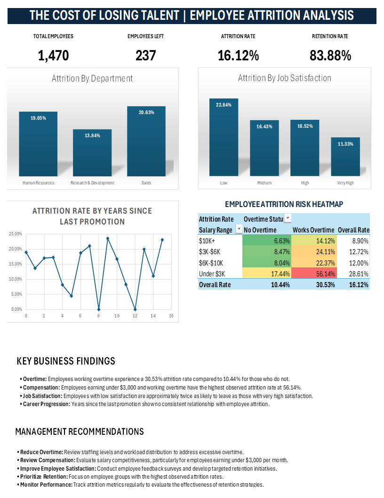

# The Cost of Losing Talent
### Employee Attrition & Retention Analysis
## Dashboard Preview
## Dashboard Preview

## Project Overview
This project examines employee attrition patterns to identify workforce retention risks and provide actionable, data-driven recommendations for management.

## Business Objective
Identify which workplace conditions and employee characteristics are associated with higher turnover rates and determine where management should prioritize retention efforts.

## Key Performance Indicators

| Metric | Result |
|---|---:|
| Total Employees | 1,470 |
| Employees Lost | 237 |
| Attrition Rate | 16.12% |
| Retention Rate | 83.88% |

## Tools & Technical Skills
- Microsoft Excel
- Data Cleaning and Preparation
- PivotTables and PivotCharts
- Conditional Formatting
- Risk Heatmap Analysis
- KPI Development
- Dashboard Design
- Business Intelligence and Reporting

## Key Findings
- Employees working overtime experienced a 30.53% attrition rate, compared to 10.44% among employees not working overtime.
- Employees earning under $3,000 monthly and working overtime experienced the highest observed attrition rate at 56.14%.
- Sales recorded the highest departmental attrition rate at 20.63%.
- Employees with low job satisfaction experienced approximately twice the attrition rate of those with very high satisfaction.
- Years since last promotion showed no consistent relationship with employee attrition.

## Strategic Recommendations
- Evaluate overtime requirements and staffing levels.
- Review compensation structures for lower-income employees.
- Implement regular employee satisfaction assessments.
- Prioritize retention initiatives for high-risk employee groups.
- Monitor workforce retention metrics regularly.

## Dataset & Limitations
The analysis uses a workforce dataset identified as the IBM HR Analytics Employee Attrition & Performance dataset.

Findings represent observed associations rather than proven causal relationships. Financial turnover costs were not calculated, and smaller employee groups may produce less reliable percentages.

## Conclusion
The analysis highlights overtime, compensation, and job satisfaction as important areas for further investigation and targeted retention strategies. By monitoring these factors, organizations can better prioritize workforce management decisions.
